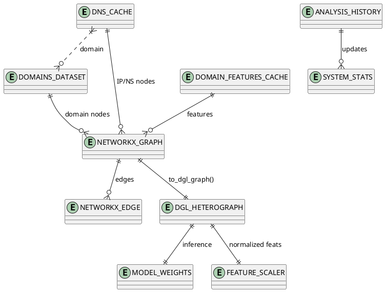

# PhishNet-GNN: Entity-Relationship Diagram (Actual Implementation)

## ER Diagram (Mermaid)

```mermaid
erDiagram
    %% ==================== ACTUAL DATABASE TABLES ====================
    
    DNS_CACHE {
        string domain PK "Domain name (FQDN)"
        text ip_addresses "JSON array of resolved IPs"
        text nameservers "JSON array of NS hostnames"
        string dns_status "resolved/partial/failed"
        real resolved_at "Unix timestamp"
        integer ttl "Cache TTL in seconds (default 86400)"
    }
    
    %% ==================== DATA FILES (CSV) ====================
    
    DOMAINS_DATASET {
        string domain PK "Domain name (FQDN)"
        integer label "0=Benign, 1=Phishing"
        string source "tranco/phishtank/openphish/synthetic"
    }
    
    DOMAIN_FEATURES_CACHE {
        string domain PK "Domain name (FQDN)"
        real domain_length "Total FQDN length"
        real subdomain_count "Number of subdomains"
        real dot_count "Dot count"
        real hyphen_count "Hyphen count"
        real digit_count "Digit count"
        real special_char_count "Special char count"
        real entropy "Shannon entropy"
        real has_ip "IP pattern flag (0/1)"
        real vowel_ratio "Vowel/alpha ratio"
        real digit_ratio "Digit/total ratio"
        real is_punycode "Punycode flag (0/1)"
        real tld_length "TLD length"
        real longest_word_length "Max segment length"
        real suspicious_tld "Risky TLD flag (0/1)"
        real brand_similarity "Min edit distance to top brands (0-20)"
        real consonant_sequence "Longest consonant run"
        real contains_login_keywords "Login keyword flag (0/1)"
        real num_a_records "Resolved A-record count"
        real num_ns_records "Resolved NS-record count"
        real dns_resolved "DNS success flag (0/1)"
        real dns_failed "DNS failure flag (0/1)"
    }
    
    %% ==================== RUNTIME GRAPH (IN-MEMORY) ====================
    
    NETWORKX_GRAPH {
        string node_id PK "d_<domain> / ip_<ip> / ns_<ns>"
        string node_type "domain / ip / nameserver"
        string domain "Domain name (for domain nodes)"
        integer label "0/1 (for domain nodes)"
        json feature_vector "21-dim feature vector (domain only)"
        string ip_address "IP address (for ip nodes)"
        string nameserver "NS hostname (for ns nodes)"
    }
    
    NETWORKX_EDGE {
        string source_id FK "References NETWORKX_GRAPH.node_id"
        string target_id FK "References NETWORKX_GRAPH.node_id"
        string edge_type "has_ip / has_ns"
    }
    
    %% ==================== DGL HETEROGRAPH (RUNTIME) ====================
    
    DGL_HETEROGRAPH {
        string node_type "domain / ip / nameserver"
        int num_nodes "Count per node type"
        string canonical_etypes "domain:has_ip:ip, ip:ip_of:domain, domain:has_ns:nameserver, nameserver:ns_of:domain, domain:self:domain"
        string domain_features "Tensor [N_domain, 21]"
        string domain_labels "Tensor [N_domain]"
        string ip_features "Tensor [N_ip, 1] (degree)"
        string ns_features "Tensor [N_ns, 1] (degree)"
    }
    
    %% ==================== MODEL ARTIFACTS ====================
    
    MODEL_WEIGHTS {
        string path PK "models/saved/phish_rgcn.pt"
        string architecture "PhishRGCN (3-layer HeteroGraphConv)"
        integer hidden_dim "128"
        integer num_layers "3"
        real dropout "0.3"
        real test_accuracy "0.9507"
        real precision "0.9445"
        real recall "0.9572"
        real f1_score "0.9508"
        real roc_auc "0.9870"
        datetime trained_at "Training timestamp"
    }
    
    FEATURE_SCALER {
        string path PK "models/saved/scaler.pkl"
        string type "StandardScaler (sklearn)"
        integer n_features "21"
    }
    
    %% ==================== FLASK API STATE (IN-MEMORY) ====================
    
    ANALYSIS_HISTORY {
        int index PK "Array position (0 = latest)"
        string domain "Analyzed domain"
        string url "Original URL"
        real risk_score "0-100"
        real probability "0.0-1.0"
        string verdict "PHISHING / BENIGN"
        string classification "malicious / suspicious / safe"
        real confidence "70-99"
        string model_mode "DGL_RGCN / SKLEARN_FALLBACK"
        string model_name "PhishRGCN-v2 / Baseline Fallback"
        json top_risk_factors "Array of risk strings"
        json features "Key feature snapshot"
        json dns_info "DNS resolution details"
        json graph_nodes "Visualization nodes"
        json graph_edges "Visualization edges"
        real response_time_ms "End-to-end latency"
        string timestamp "ISO datetime"
    }
    
    SYSTEM_STATS {
        string key PK "Metric name"
        string value "Metric value"
        %% total_analyzed, threats_detected, start_time, model_accuracy
    }
    
    %% ==================== RELATIONSHIPS ====================
    
    %% DNS Cache -> Domains Dataset (for graph building)
    DNS_CACHE }|..o{ DOMAINS_DATASET : "domain (join key)"
    
    %% Domain Features Cache -> Domains Dataset
    DOMAIN_FEATURES_CACHE }|..o{ DOMAINS_DATASET : "domain (join key)"
    
    %% Graph Construction Pipeline
    DOMAINS_DATASET ||--o{ NETWORKX_GRAPH : "domain nodes (1 per domain)"
    DNS_CACHE ||--o{ NETWORKX_GRAPH : "IP & NS nodes (exploded)"
    DOMAIN_FEATURES_CACHE ||--o{ NETWORKX_GRAPH : "features → domain nodes"
    NETWORKX_GRAPH ||--o{ NETWORKX_EDGE : "edges (has_ip, has_ns)"
    
    %% NetworkX → DGL Conversion
    NETWORKX_GRAPH ||--|| DGL_HETEROGRAPH : "to_dgl_graph()"
    NETWORKX_EDGE ||--|| DGL_HETEROGRAPH : "edge_index tensors"
    
    %% Model Inference
    DGL_HETEROGRAPH ||--|| MODEL_WEIGHTS : "forward pass"
    FEATURE_SCALER ||--|| DGL_HETEROGRAPH : "feature normalization (training)"
    
    %% API Runtime
    DNS_CACHE }|..o{ ANALYSIS_HISTORY : "live DNS lookup"
    DOMAIN_FEATURES_CACHE }|..o{ ANALYSIS_HISTORY : "feature extraction"
    MODEL_WEIGHTS }|..o{ ANALYSIS_HISTORY : "GNN inference"
    ANALYSIS_HISTORY ||--o{ SYSTEM_STATS : "updates counters"
```



---

## Actual Database Schema (SQLite)

### `data/dns_cache.db` - Single Table

```sql
CREATE TABLE dns_cache (
    domain TEXT PRIMARY KEY,              -- FQDN (e.g., "google.com")
    ip_addresses TEXT,                    -- JSON array: ["142.250.190.46", "..."]
    nameservers TEXT,                     -- JSON array: ["ns1.google.com", "..."]
    dns_status TEXT,                      -- "resolved" | "partial" | "failed"
    resolved_at REAL,                     -- Unix timestamp (time.time())
    ttl INTEGER DEFAULT 86400             -- Cache TTL in seconds (24h)
);

-- Current stats: ~9,997 cached domains
```

### `data/domains_dataset.csv` - Training Data

```csv
domain,label,source
google.com,0,tranco
g00gle-login.xyz,1,synthetic
paypa1-update.ml,1,synthetic
github.com,0,tranco
...
-- ~9,992 rows (5,000 phishing + 4,992 benign)
```

### `models/saved/domain_features.csv` - Cached Features (Training)

```csv
domain,domain_length,subdomain_count,dot_count,...,dns_failed
google.com,10,0,1,...,0
g00gle-login.xyz,16,1,2,...,0
...
-- One row per domain, 21 feature columns + domain
```

---

## Data Flow (Actual Implementation)

```
┌─────────────────────────────────────────────────────────────────────────────┐
│                        OFFLINE TRAINING PIPELINE                            │
├─────────────────────────────────────────────────────────────────────────────┤
│                                                                             │
│  domains_dataset.csv (CSV)                                                 │
│       │                                                                     │
│       ▼                                                                     │
│  ┌─────────────────────┐     ┌─────────────────────┐                       │
│  │  DNSResolver        │     │  FeatureExtractor   │                       │
│  │  .resolve_batch()   │     │  .extract_features_ │                       │
│  │  → dns_cache.db     │     │  _batch()           │                       │
│  └──────────┬──────────┘     └──────────┬──────────┘                       │
│             │                           │                                  │
│             ▼                           ▼                                  │
│  ┌─────────────────────────────────────────────────┐                       │
│  │  DomainGraphBuilder.build_graph()               │                       │
│  │  (NetworkX: domain + IP + NS nodes, edges)      │                       │
│  └────────────────────┬────────────────────────────┘                       │
│                       │                                                    │
│                       ▼                                                    │
│  ┌─────────────────────────────────────────────────┐                       │
│  │  .to_dgl_graph(feature_cols)                    │                       │
│  │  → DGL HeteroGraph with:                        │                       │
│  │  - 3 node types: domain, ip, nameserver         │                       │
│  │  - 5 canonical edge types (+ self-loops)        │                       │
│  │  - domain features: [N, 21]                     │                       │
│  │  - ip/ns features: [N, 1] (degree)              │                       │
│  └────────────────────┬────────────────────────────┘                       │
│                       │                                                    │
│                       ▼                                                    │
│  ┌─────────────────────────────────────────────────┐                       │
│  │  PhishRGCN Training                             │                       │
│  │  - 3 HeteroGraphConv layers                     │                       │
│  │  - Focal Loss + Adam (lr=0.001)                 │                       │
│  │  - Early stopping                               │                       │
│  └────────────────────┬────────────────────────────┘                       │
│                       │                                                    │
│                       ▼                                                    │
│  ┌─────────────────────────────────────────────────┐                       │
│  │  MODEL ARTIFACTS                                │                       │
│  │  - models/saved/phish_rgcn.pt (weights)         │                       │
│  │  - models/saved/scaler.pkl (StandardScaler)     │                       │
│  │  - models/saved/domain_features.csv (cache)     │                       │
│  └─────────────────────────────────────────────────┘                       │
│                                                                             │
└─────────────────────────────────────────────────────────────────────────────┘

┌─────────────────────────────────────────────────────────────────────────────┐
│                      REAL-TIME INFERENCE PIPELINE                           │
├─────────────────────────────────────────────────────────────────────────────┤
│                                                                             │
│  User → POST /api/analyze {"domain": "example.com"}                        │
│       │                                                                     │
│       ▼                                                                     │
│  Flask: analyze_domain(domain)                                             │
│       │                                                                     │
│       ├──► DNSResolver.resolve_domain() → dns_cache.db (live or cached)   │
│       │                                                                     │
│       ├──► FeatureExtractor.extract_domain_features()                     │
│       │       (21 lexical + DNS features)                                  │
│       │                                                                     │
│       ├──► predict_url() → _run_gnn_forward_pass()                         │
│       │       │                                                             │
│       │       ├──► Load domains_dataset.csv + dns_cache.db                 │
│       │       ├──► Load domain_features.csv (cached features)              │
│       │       ├──► Build graph (new domain + cached context)               │
│       │       ├──► Load phish_rgcn.pt                                      │
│       │       └──► Forward pass → probability                              │
│       │                                                                     │
│       └──► Build visualization graph (domain + IP + NS nodes)              │
│       │                                                                     │
│       ▼                                                                     │
│  Response JSON: {risk_score, verdict, probability, top_risk_factors,      │
│                  graph: {nodes, edges}, model_mode, response_time_ms}      │
│       │                                                                     │
│       ▼                                                                     │
│  analysis_history[] (in-memory, max 1000)                                  │
│  system_stats (in-memory counters)                                         │
│                                                                             │
└─────────────────────────────────────────────────────────────────────────────┘
```

---

## Graph Topology (Actual: 3 Node Types, 5 Edge Types)

```
NETWORKX GRAPH (Undirected)          DGL HETEROGRAPH (Directed, Bidirectional)

    ┌─────────────┐                      Node Types:
    │  DOMAIN     │  (label, 21 feats)    1. domain  →  features [N, 21], labels [N]
    │  (label=0/1)│                      2. ip       →  features [N, 1] (degree)
    └──────┬──────┘                      3. nameserver → features [N, 1] (degree)
           │
     ┌─────┴─────┐
     │           │
     ▼           ▼
┌─────────┐ ┌──────────┐
│   IP    │ │ NAMESERVER│  (degree=1 feats)
│ (ip)    │ │    (ns)   │
└─────────┘ └──────────┘

Edge Types (canonical_etypes):
  ('domain', 'has_ip',       'ip')           Forward: domain → ip
  ('ip',       'ip_of',      'domain')       Reverse: ip → domain  
  ('domain', 'has_ns',       'nameserver')   Forward: domain → ns
  ('nameserver','ns_of',      'domain')       Reverse: ns → domain
  ('domain', 'self',         'domain')       Self-loops for all domains

Total edges per domain: up to 2 IPs × 2 directions + 2 NS × 2 directions + 1 self-loop = 9
```

---

## Flask API Endpoints (Actual)

| Endpoint | Method | Description |
|----------|--------|-------------|
| `/` | GET | Serves dashboard (static/index.html) |
| `/dashboard` | GET | Serves dashboard |
| `/api/analyze` | POST | Single domain analysis |
| `/api/batch-analyze` | POST | Up to 100 domains |
| `/api/stats` | GET | System stats + verified model metrics |
| `/api/graph-data` | GET | Real graph from dns_cache.db (for viz) |
| `/api/recent` | GET | Last N analyses from memory |
| `/api/health` | GET | Health check + model mode |

---

## Usage in Report

### Mermaid (Markdown/LaTeX with Mermaid support)

```markdown
```mermaid
erDiagram
    DNS_CACHE {
        string domain PK
        text ip_addresses
        text nameservers
        string dns_status
        real resolved_at
        integer ttl
    }
    DOMAINS_DATASET {
        string domain PK
        integer label
        string source
    }
    DOMAIN_FEATURES_CACHE {
        string domain PK
        real domain_length
        real entropy
        real brand_similarity
        ... 21 features total
    }
    NETWORKX_GRAPH {
        string node_id PK
        string node_type
        string domain
        integer label
        json feature_vector
    }
    NETWORKX_EDGE {
        string source_id FK
        string target_id FK
        string edge_type
    }
    DGL_HETEROGRAPH {
        string node_type
        int num_nodes
        string canonical_etypes
    }
    MODEL_WEIGHTS {
        string path PK
        string architecture
        real test_accuracy
    }
    ANALYSIS_HISTORY {
        int index PK
        string domain
        real risk_score
        string verdict
        string model_mode
    }

    DNS_CACHE }|..o{ DOMAINS_DATASET : "domain"
    DOMAINS_DATASET ||--o{ NETWORKX_GRAPH : "domain nodes"
    DNS_CACHE ||--o{ NETWORKX_GRAPH : "IP/NS nodes"
    DOMAIN_FEATURES_CACHE ||--o{ NETWORKX_GRAPH : "features"
    NETWORKX_GRAPH ||--o{ NETWORKX_EDGE : "edges"
    NETWORKX_GRAPH ||--|| DGL_HETEROGRAPH : "to_dgl_graph()"
    DGL_HETEROGRAPH ||--|| MODEL_WEIGHTS : "inference"
    ANALYSIS_HISTORY ||--o{ SYSTEM_STATS : "updates"
```
```

### PlantUML



---

## Key Implementation Notes for Report

1. **Single SQLite table** (`dns_cache`) - not normalized; stores JSON arrays for IPs/NS
2. **CSV files** for training data (`domains_dataset.csv`) and cached features (`domain_features.csv`)
3. **In-memory** Flask state (`analysis_history[]`, `system_stats`) - not persisted
4. **Graph built per-inference** from cached context + live domain (not stored)
5. **DGL HeteroGraph** with 3 node types, 5 canonical edge types (bidirectional + self-loops)
6. **21 features** per domain (lexical + DNS-aware), padded to 16-dim in DGL for ip/ns nodes